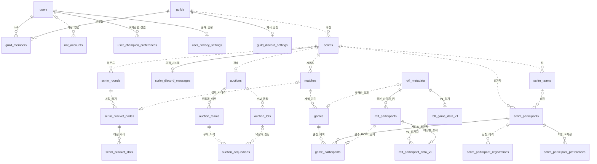
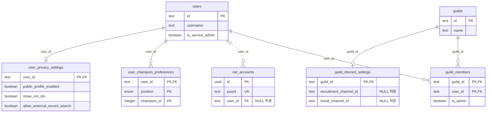
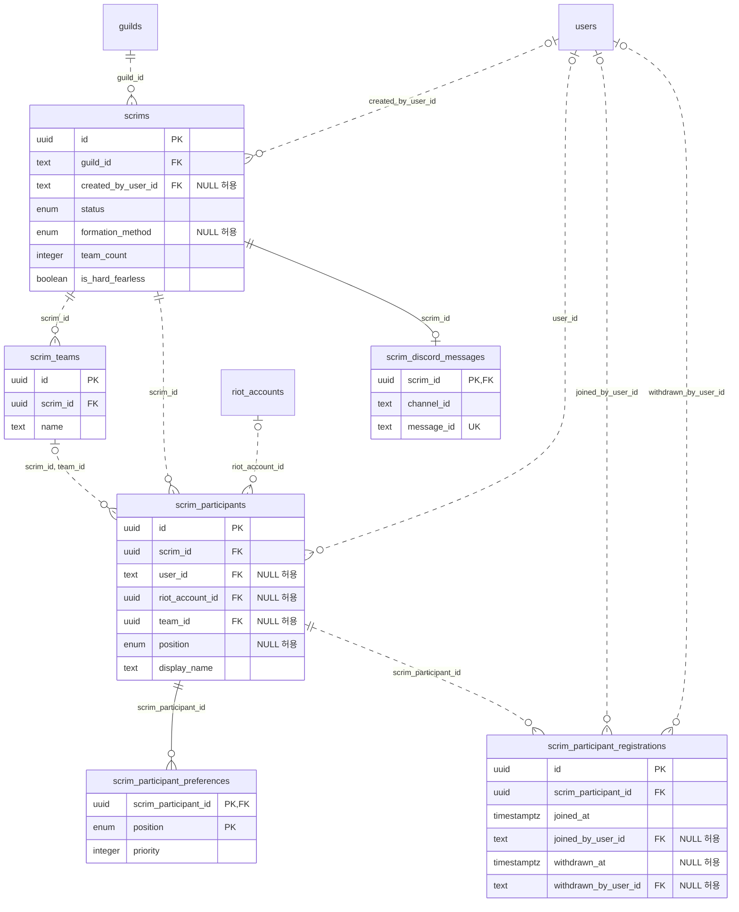
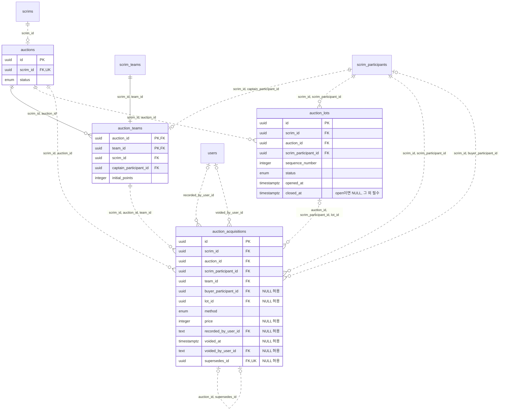
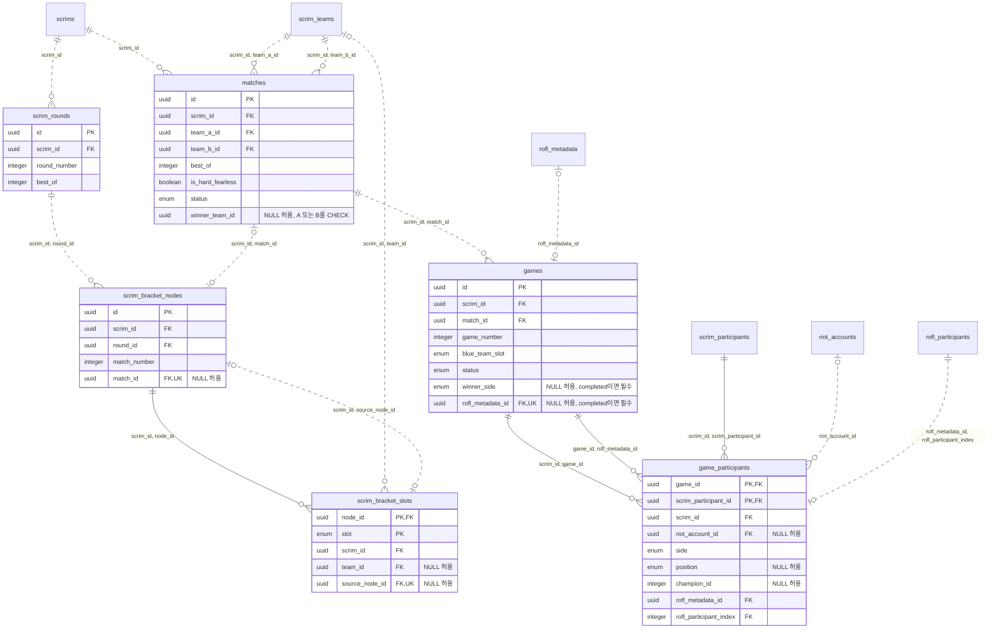
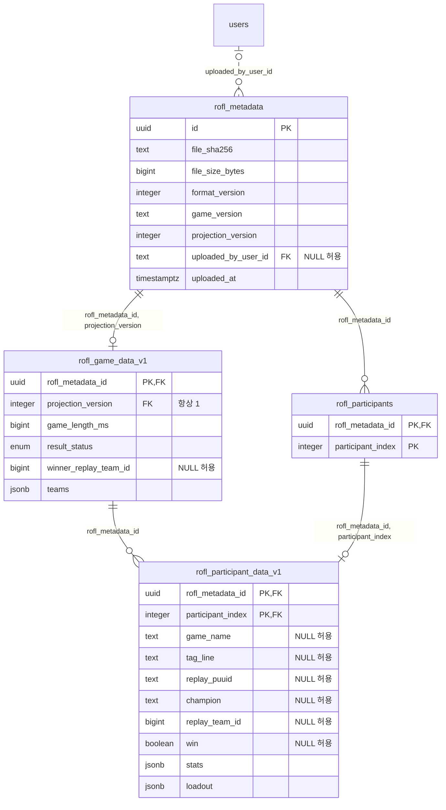

# MSM2 데이터베이스 ERD

기준: [schema.ts](../apps/web/src/lib/server/db/schema.ts)의 **27개 테이블·53개 외래키**.
아래는 스키마 정의이며, 현재 DB에 이 전체 구조를 마이그레이션한 상태는 아니다.

서비스는 모집·팀 편성·경매·대진을 관리하고, 경기 최종 결과는 ROFL에서 받아 기록한다.
밴픽 진행·픽 순서·수동 결과 승인 모델과 원본 ROFL 보관 테이블은 없다.

## 전체 개요

모든 테이블과 대표 관계를 표시한다. 역할이 다른 외래키와 복합키는 아래 상세 ERD에 표시한다.

## 상세 표기

- `||`: 정확히 하나, `o|`: 없거나 하나, `o{`: 없거나 여러 개.
- 실선은 부모 키가 자식 기본키에 포함되는 식별 관계, 점선은 그 외 관계다.
- `PK`가 여러 열에 있으면 하나의 복합 기본키다. `FK`는 외래키 구성 열이며, `UK`는 단일 열 고유키다.
- 필드는 관계와 주요 상태 위주로 발췌했다. `NULL 허용` 표시가 없는 표시 필드는 필수다.
- 상세 ERD의 연결선은 실제 DB 외래키 53개를 각각 나타낸다. Drizzle 조회용 `relations` 자체가 DB 제약을 추가하지는 않는다.

## 사용자·길드·계정

## 모집·팀 편성

동일 내전에서 사용자·Riot 계정은 중복 참가할 수 없고, 팀별 배정 포지션도 중복되지 않는다.
참가 신청은 여러 이력을 남기되 `withdrawn_at IS NULL`인 활성 신청은 참가자당 하나다.

## 경매·구매 이력

경매는 내전당 하나이므로 한 팀·참가자가 연결되는 경매 팀 행도 각각 최대 하나다.
열린 경매 후보는 경매당 하나, 무효화되지 않은 영입은 경매·참가자당 하나다.
낙찰은 구매자·경매 시도·비음수 가격이 필수이고, 수동 배정은 구매자·가격이 `NULL`이다.
정정은 기존 행을 무효화하고 새 행의 `supersedes_id`로 연결해 구매 이력을 남긴다.

## 라운드·대진·경기 결과

`Match`는 두 팀의 시리즈이고 `Game`은 개별 한 판이다. 점수는 완료 Game에서 집계한다.
`winner_team_id`는 별도 FK가 아니라 A/B 팀 중 하나인지 확인하는 `CHECK`로 제한한다.
대진 자리는 직접 지정한 팀 또는 이전 대진의 승자 중 하나를 참조하며 둘 다 미정일 수도 있다.

출전 기록의 ROFL 참조는 필수다. `(game_id, rofl_metadata_id)` FK가 해당 Game의 채택본과 연결되도록 하고,
`(rofl_metadata_id, rofl_participant_index)` FK가 실제 ROFL 참가자 존재를 보장한다.
Game의 채택 메타 고유키와 Game별 ROFL 인덱스 고유키 때문에 ROFL 참가자당 출전 기록은 최대 하나다.
같은 두 ROFL 참조 열에는 역조회용 복합 인덱스가 있다.

## ROFL 공통 메타·버전별 결과

원본 파일·전체 메타데이터·패킷은 저장하지 않는다. 지문·버전과 P0~P2 선별 결과만 저장한다.
`(file_sha256, projection_version)`은 고유하고 V1 하위 모델은 공통 메타의 버전 1만 참조한다.
서비스 참가자를 아직 연결하지 못한 ROFL 참가자는 공통 키와 버전별 결과에 남기며,
ROFL 근거 없는 `game_participants` 행을 먼저 만들지 않는다.

## 함께 적용되는 제약

- 복합 FK의 `scrim_id`는 서로 다른 내전의 팀·참가자·Match·Game·대진이 연결되지 않도록 한다.
- 사용자 삭제 시 멤버십·개인 설정은 삭제되고, 과거 참가·업로더·작업자 연결은 `SET NULL`로 해제된다. 경기·경매 이력의 참조는 `RESTRICT`로 보호한다.
- 하드 피어리스는 안내 규칙이며 업로드를 막는 DB 제약이 없다.
- 팀 정원·경매 예산 합계·대진 순환·시리즈 종료 점수는 단일 행의 관계만으로 보장하지 않는다. 이 문서의 ERD가 해당 동작의 구현 완료를 뜻하지는 않는다.
