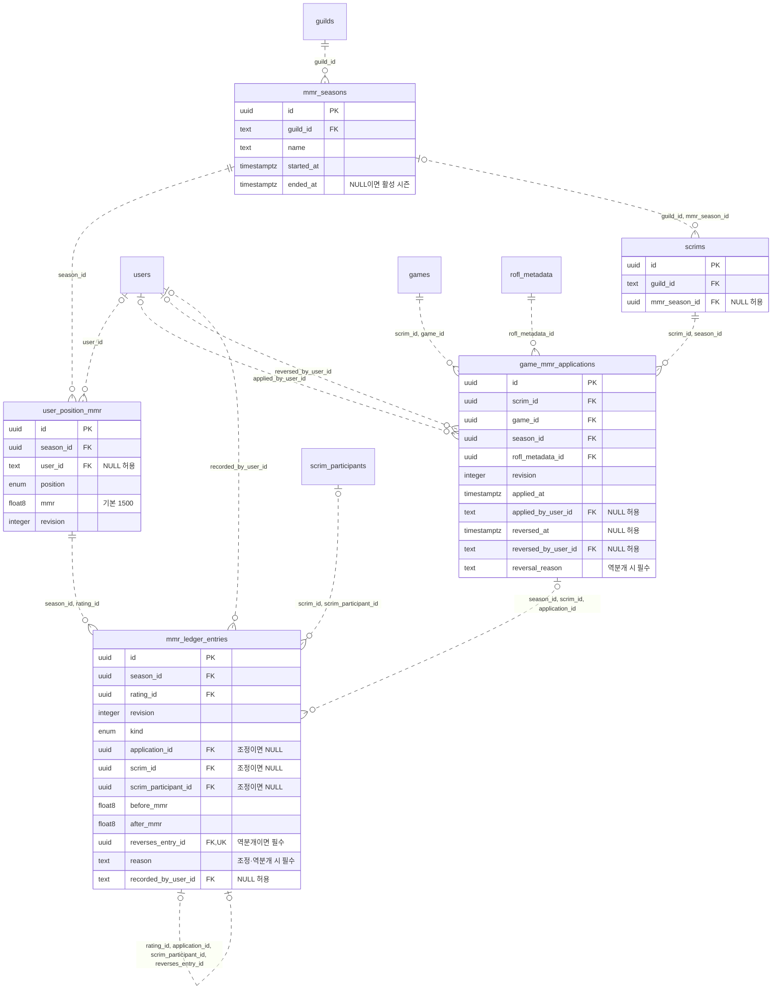
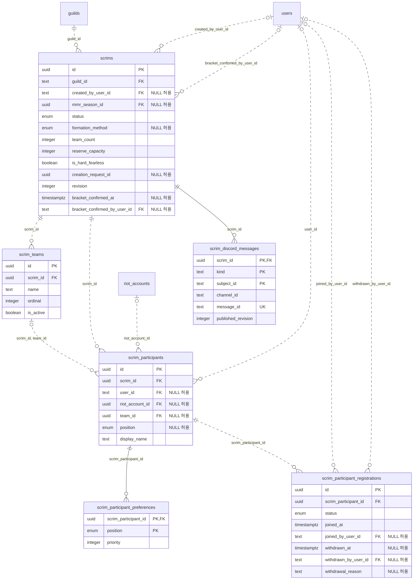
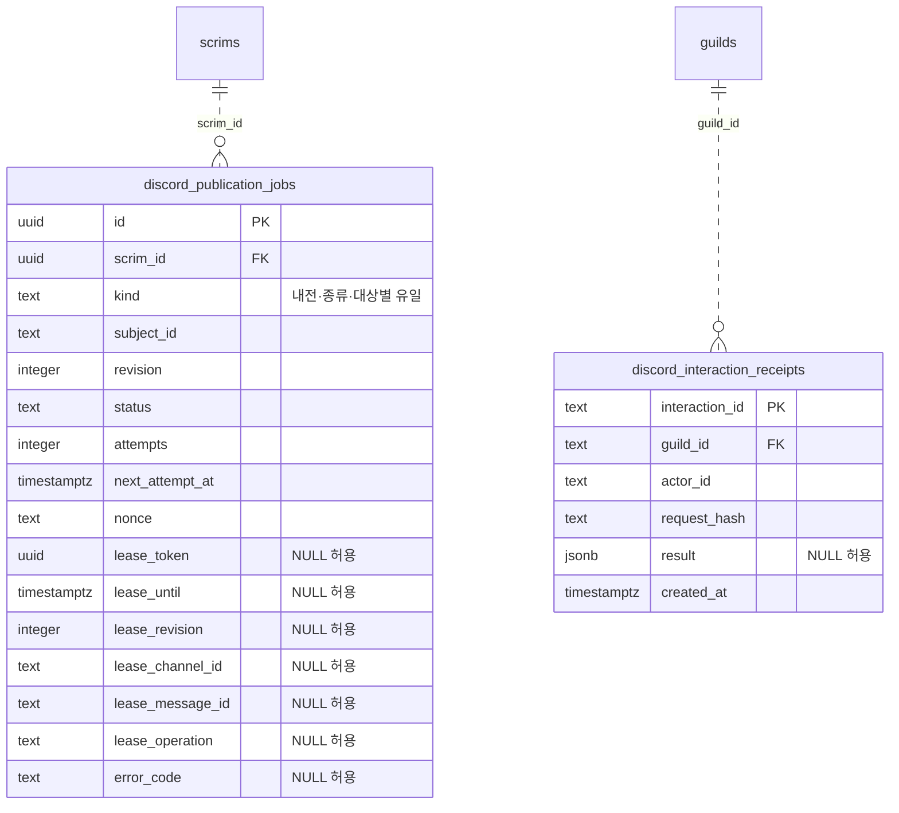
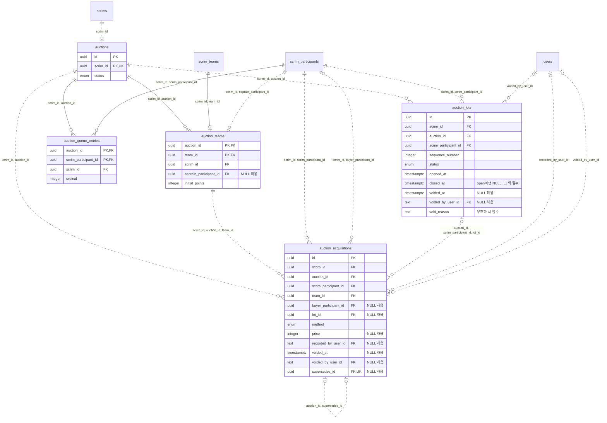
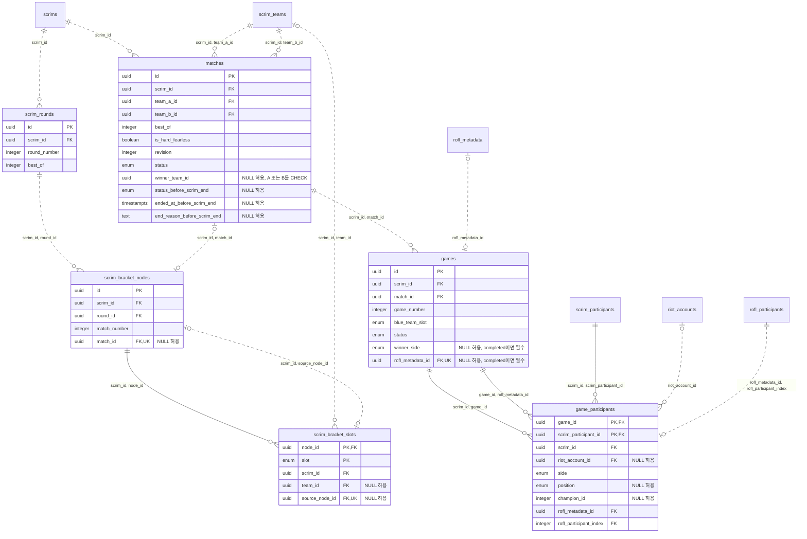
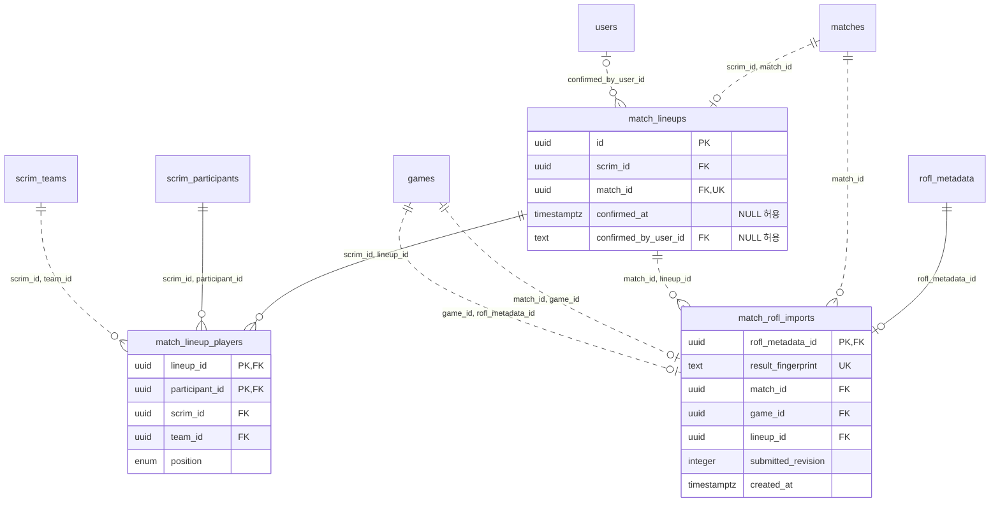
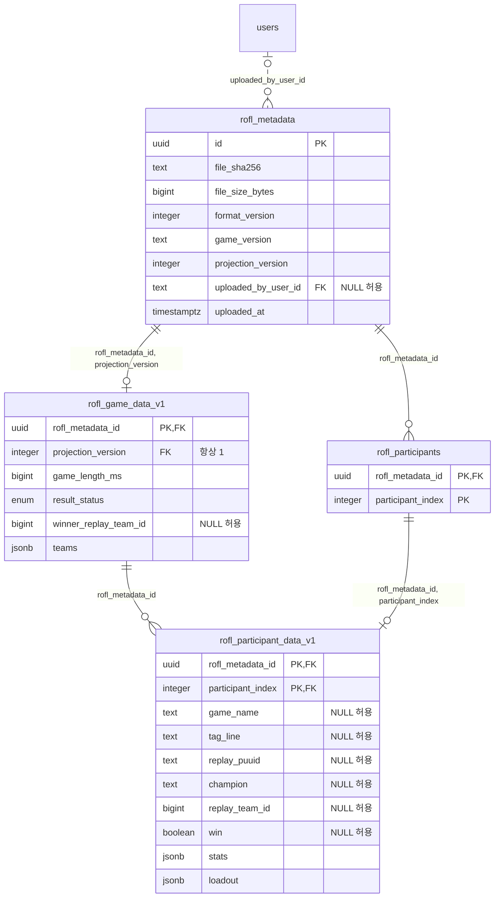

# MSM2 데이터베이스 ERD

기준: 2026-11-05 [schema.ts](../apps/web/src/lib/server/db/schema.ts)의 **40개 테이블·88개 외래키**.
전체 초기 생성 기준은 [0000_initial_schema.sql](../apps/web/drizzle/0000_initial_schema.sql)과 [0001_discord_bot.sql](../apps/web/drizzle/0001_discord_bot.sql), Drizzle snapshot·journal이다.
게시 점유의 필수 operation 제약은 [0002_discord_lease_constraint.sql](../apps/web/drizzle/0002_discord_lease_constraint.sql)로 강화한다.
경기 라인업·결과 이력·게시 대상 확장은 [0003_match_results.sql](../apps/web/drizzle/0003_match_results.sql)에 포함한다.
인증·서버별 계정·모집·편성·대진·진행 상태와 ROFL 결과·MMR 자동 반영은 실제 DB를 사용한다.

서비스는 모집·팀 편성·경매·대진을 관리하고, 경기 최종 결과는 ROFL에서 받아 기록한다.
밴픽 진행·픽 순서·수동 결과 승인 모델과 원본 ROFL 보관 테이블은 없다.

## 전체 개요

모든 테이블과 대표 관계를 표시한다. 역할이 다른 외래키와 복합키는 아래 상세 ERD에 표시한다.

```mermaid
erDiagram
    users ||--o{ guild_members : 소속
    guilds ||--o{ guild_members : 구성원
    users ||..o{ sessions : 로그인_세션
    users ||..o{ guild_riot_accounts : 서버별_계정_연결
    guilds ||--o{ guild_riot_accounts : 계정_연결_범위
    riot_accounts ||--o{ guild_riot_accounts : Riot_식별자
    users ||--o{ user_champion_preferences : 포지션별_선호
    guilds ||--o| guild_discord_settings : 게시_설정
    guilds ||--o{ guild_discord_roles : 역할_선택지
    guilds ||--o{ guild_discord_channels : 채널_선택지

    guilds ||..o{ mmr_seasons : MMR_시즌
    mmr_seasons ||..o{ user_position_mmr : 포지션별_점수
    users |o..o{ user_position_mmr : MMR_소유자
    mmr_seasons |o..o{ scrims : 반영_시즌
    games ||..o{ game_mmr_applications : MMR_반영_회차
    rofl_metadata ||..o{ game_mmr_applications : 반영_근거
    user_position_mmr ||..o{ mmr_ledger_entries : 점수_원장
    game_mmr_applications |o..o{ mmr_ledger_entries : 경기별_변경

    guilds ||..o{ scrims : 내전
    scrims ||..o{ scrim_teams : 팀
    scrims ||..o{ scrim_participants : 참가자
    scrim_teams |o..o{ scrim_participants : 배정
    scrim_participants ||--o{ scrim_participant_preferences : 희망_포지션
    scrim_participants ||..o{ scrim_participant_registrations : 신청_이력
    scrims ||--o{ scrim_discord_messages : 종류별_게시물
    scrims ||..o{ discord_publication_jobs : 게시_작업
    matches ||..o| match_lineups : 경기_전체_라인업
    match_lineups ||--o{ match_lineup_players : 출전_포지션
    matches ||..o{ match_rofl_imports : ROFL_등록_이력
    guilds ||..o{ discord_interaction_receipts : 요청_처리_기록

    scrims ||..o| auctions : 경매
    auctions ||--o{ auction_teams : 팀장과_예산
    auctions ||--o{ auction_queue_entries : 후보_대기열
    auctions ||..o{ auction_lots : 후보_등장
    auction_teams ||..o{ auction_acquisitions : 구매_이력
    auction_lots |o..o{ auction_acquisitions : 낙찰과_정정

    scrims ||..o{ scrim_rounds : 라운드
    scrim_rounds ||..o{ scrim_bracket_nodes : 계획_경기
    scrim_bracket_nodes ||--o{ scrim_bracket_slots : 대진_자리
    matches |o..o| scrim_bracket_nodes : 실제_경기
    scrims ||..o{ matches : 경기
    matches ||..o{ games : 개별_게임
    games ||--o{ game_participants : 출전_기록
    scrim_participants ||--o{ game_participants : 서비스_참가자

    rofl_metadata |o..o| games : 채택한_결과
    rofl_metadata ||--o{ rofl_participants : 원본_참가자_키
    rofl_metadata ||--o| rofl_game_data_v1 : V1_경기
    rofl_game_data_v1 ||--o{ rofl_participant_data_v1 : V1_참가자
    rofl_participants ||--o| rofl_participant_data_v1 : 버전별_상세
    rofl_participants ||..o| game_participants : 필수_ROFL_근거
```

## 상세 표기

- `||`: 정확히 하나, `o|`: 없거나 하나, `o{`: 없거나 여러 개.
- 실선은 부모 키가 자식 기본키에 포함되는 식별 관계, 점선은 그 외 관계다.
- `PK`가 여러 열에 있으면 하나의 복합 기본키다. `FK`는 외래키 구성 열이며, `UK`는 단일 열 고유키다.
- 필드는 관계와 주요 상태 위주로 발췌했다. `NULL 허용` 표시가 없는 표시 필드는 필수다.
- 상세 ERD의 연결선은 스키마의 외래키를 나타낸다. 전체 제약은 88개이며 Drizzle 조회용 `relations` 자체가 DB 제약을 추가하지는 않는다.

## 사용자·길드·계정

```mermaid
erDiagram
    users {
        text id PK
        text username
        boolean is_service_admin
    }
    sessions {
        text token_hash PK
        text user_id FK
        timestamptz created_at
        timestamptz expires_at
    }
    guilds {
        text id PK
        text name
        boolean is_active
        timestamptz synced_at "NULL 허용"
    }
    guild_members {
        text guild_id PK, FK
        text user_id PK, FK
        boolean is_admin "표시용 동기화 값"
        boolean manage_guild
        text_array role_ids
        timestamptz synced_at "NULL 허용"
    }
    riot_accounts {
        uuid id PK
        text puuid UK
        text game_name "NULL 허용"
        text tag_line "NULL 허용"
        text platform "NULL 허용"
    }
    guild_riot_accounts {
        text guild_id PK, FK
        uuid riot_account_id PK, FK
        text user_id FK
        boolean is_primary
        text linked_by_user_id FK "NULL 허용"
        timestamptz linked_at
    }
    user_champion_preferences {
        text user_id PK, FK
        enum position PK
        integer champion_id PK
    }
    guild_discord_settings {
        text guild_id PK, FK
        text operator_role_id "NULL 허용"
        text recruitment_channel_id "NULL 허용"
        text entry_channel_id "NULL 허용"
        text result_channel_id "NULL 허용"
    }
    guild_discord_roles {
        text guild_id PK, FK
        text role_id PK
        text name
        integer position
    }
    guild_discord_channels {
        text guild_id PK, FK
        text channel_id PK
        text name
        text category_name "NULL 허용"
        integer position
        boolean bot_can_post
    }

    users ||--o{ guild_members : user_id
    guilds ||--o{ guild_members : guild_id
    users ||..o{ sessions : user_id
    guilds ||--o{ guild_riot_accounts : guild_id
    riot_accounts ||--o{ guild_riot_accounts : riot_account_id
    users ||..o{ guild_riot_accounts : user_id
    users |o..o{ guild_riot_accounts : linked_by_user_id
    users ||--o{ user_champion_preferences : user_id
    guilds ||--o| guild_discord_settings : guild_id
    guilds ||--o{ guild_discord_roles : guild_id
    guilds ||--o{ guild_discord_channels : guild_id
```

웹 서버는 Bot 토큰으로 Discord 소속·실효 서버 관리 권한·역할·채널을 확인하고 저장한다.
`guild_members.is_admin`만 신뢰해 조작을 허용하지 않는다. 쓰기 전 실제 Discord를 조회하고 트랜잭션 안에서도
활성·소속·동기화 시각·현재 운영자 역할 설정을 재검사한다. 역할 변경 후 실행자의 관리 권한을 유지해야 하며,
게시 채널은 채널 overwrite와 timeout을 반영해 봇의 보기·메시지 전송·메시지 기록 읽기 권한을 확인한다.

`users`는 OAuth 로그인과 검증된 Discord 멤버 응답에서 생성한다. `sessions`에는 난수 토큰의 해시와 만료만 보관한다.
일반 서버 화면은 공개 열람하고, 본인 신청·관리 조작은 별도 권한 검사를 거친다.

Riot 식별자는 PUUID 고유 행으로 재사용하고 사용자 연결은 `guild_riot_accounts`에서 **서버별**로 관리한다.
같은 계정은 서버마다 다른 사용자에게 연결될 수 있으며 `(guild_id, user_id)`의 대표 연결은 최대 하나다.
연결 해제는 해당 연결 행만 삭제한다. 해당 서버의 활성 신청이 사용하는 계정은 해제를 막고, 다른 서버의 연결·신청과
기존 `scrim_participants`·`game_participants` 기록은 보존한다. 사용자 삭제 시 연결 행은 CASCADE로 제거되며 Riot 식별자는 남는다.

## MMR 시즌·현재 점수·변동 이력

MMR은 길드·시즌·Discord 사용자·포지션별로 관리한다. 길드 탈퇴로 점수를 지우지 않으며,
사용자 삭제 시 개인 연결만 해제하고 원장은 보존한다. 내전에는 같은 길드의 시즌만 연결할 수 있다.

길드별 활성 시즌과 Game별 유효 반영은 각각 하나다. Game 반영 회차·점수 변경 revision,
반영별 사용자/참가자·원본당 역분개를 고유키로 구분한다. 변경 전·후 수치를 저장하고 증감은 두 값의 차로 구한다.
원장은 참가자·반영 회차를 참조한다. 정정할 때 기존 Game·출전·ROFL·원장을 보존하고 새 Game에 별도 결과를 등록한다.

스키마는 예외 자료의 결과 보존과 MMR 미반영을 표현할 수 있다. 정상 결과 처리에는 MSM1처럼 확정 시즌·출전 라인업을 사용하고 Game·MMR을 같은 트랜잭션으로 반영한다.
Elo 계산과 원장·현재값의 원자적 반영, 안전한 마지막 Game 역분개는 [내부 MMR 서비스](../apps/web/src/lib/server/mmr/README.md)에 구현했다.
ROFL 결과 저장·시리즈 종료·대진 진출도 같은 트랜잭션에서 처리하며 [MMR 저장 계약](mmr.md)을 따른다.

## 모집·팀 편성

동일 내전에서 사용자·Riot 계정은 중복 참가할 수 없고, 팀별 배정 포지션도 중복되지 않는다.

실출전 정원은 `team_count × 5`, 전체 신청 정원은 여기에 `reserve_capacity`를 더한 값이다.
`team_count`는 2~4, `reserve_capacity`는 기본값 0이며 0~10 범위의 정수다. 예를 들어 `team_count = 2`,
`reserve_capacity = 2`이면 10명 내전에 최대 12명의 활성 신청을 받아 최종 참가자 10명을 정할 수 있다.
신청하면 선발 수가 `team_count × 5` 미만일 때 `selected`, 아니면 `standby`가 된다.
선발자가 철회·제외되거나 팀 수가 늘어 자리가 비면 가장 먼저 신청한 대기자부터 선발한다.
모집 서비스는 운영자가 대기로 바꾸는 요청에서만 자동 충원을 건너뛴다.
이후 철회·제외·설정 변경으로 충원이 다시 실행되면 그 신청도 선발 대상이다. 수동 대기를 계속 고정하는 별도 필드는 없다.

신청 상태는 `selected`(선발), `standby`(대기), `withdrawn`(자진 철회),
`excluded`(운영자 제외)로 구분하며 기본값은 없다(서비스가 신청 시점에 정한다). `withdrawn`·`excluded`일 때만 `withdrawn_at`을 기록하며,
`withdrawn_at IS NULL`인 활성 신청은 참가자당 하나다. 제외 시에도 참가자·신청 행을 삭제하지 않고
처리 시각·행위자·사유를 남긴다. 재신청은 기존 참가자에 새 신청 행을 연결하여 이전 이력을 보존한다.

신청 정원은 전체 참가자 행 수가 아닌 활성 신청 수로 검사한다. 모집을 마감(팀 편성 시작)하려면
`selected` 수가 `team_count × 5`와 일치해야 하며, 팀 배정·경매 팀장·경매 후보·게임 출전은 선발된
참가자만 대상으로 한다. 이 인원수·상태 검사와 제외 시 미확정 팀 배정 정리는 서비스 트랜잭션에서 검사한다.
사용자·계정·내전 잠금과 `revision` 검증으로 신청과 계정 해제·운영자 동시 변경을 조정한다.

아래 단계 전이는 `server/scrims/service.ts`·`manual.ts`·`bracket.ts`·`workflow.ts`의 DB 트랜잭션에 연결했다.
`formation_method`는 운영자가 모집 중·편성 중(`preparing`)에 정하거나 바꾸며, 비어 있어도 모집을 마감할 수
있다. `ready` 이후 상태에서는 반드시 값이 있다(`scrims_formation_method_required`). 편성 중에 방식을 바꾸거나
비우면 그 내전의 수동 배정·경매 효과를 무효화하고, 모집을 다시 열면 미확정 편성을 비우되 참가·영입 이력과 방식은 유지한다.
진행 중 경매를 팀장 설정으로 되돌릴 때는 유효 영입을 무효화하고 열린 후보를 취소한 뒤 `setup`으로 바꾼다. `scrim_teams.name`은 입력받지 않고 팀 순서대로
`포로팀`·`칼날부리팀`·`돌거북팀`·`바위게팀`을 붙인다.

내전 단계는 운영자가 한 단계씩 되돌릴 수 있다(편성 중 → 모집 중, 대진 준비 → 편성 중, 게임 기록이 없는
진행 중 → 대진 준비, 종료·중도 종료 → 진행 중). 중도 종료는 진행 중 Match를 `ended_early`, 시작 전 Match를
`cancelled`로 바꾸며 기록된 Game과 점수는 보존한다. 되돌릴 때도 Game을 지우지 않는다.

## Discord 작업과 요청 기록

신청 변경·게시 작업·interaction 성공 결과를 같은 트랜잭션에서 커밋한다. 실패 시 모두 롤백한다.
게시 작업은 최신 목표 버전을 하나로 합치며 `pending`·`processing`·`sent`·`blocked`·`uncertain` 상태로 관리한다.
전송은 DB 트랜잭션 밖에서 수행하고 점유 토큰·만료·처리 버전으로 오래된 응답을 거절한다.
채널 이동은 이전 글 삭제 뒤 새 글 생성으로 처리한다. 신규 전송 응답 유실은 `uncertain`으로 남겨 운영자가 대조한다.
요청 기록의 actor ID는 원래 실행자의 식별값을 보존하며 사용자의 현재 권한을 대신하지 않는다.

`scrim_discord_messages`의 기본키와 `discord_publication_jobs`의 고유키는 모두 `(scrim_id, kind, subject_id)`다.
대상의 귀속은 서비스에서 확인하며 `subject_id`는 아래 종류에 따라 해석한다.

| kind | subject_id | 게시 대상 |
| --- | --- | --- |
| `recruitment` | `scrim` | 모집 안내와 신청 버튼 |
| `entry` | `scrim` | 확정된 내전 팀 구성 |
| `lineup` | `match_lineups.id` | 경기 전체의 확정 출전 라인업 |
| `result` | `games.id` | 채택한 Game의 결과 |
| `confirmation_dm` | Discord 사용자 ID | 선발 확정 개인 알림 |

`processing`에는 점유 토큰·만료·버전·작업 종류가 필수다. 길드 게시에는 채널 ID도 필요하지만,
DM은 봇이 채널을 열기 전까지 `lease_channel_id`가 null일 수 있다. 성공 ACK가 실제 채널·메시지 ID를 저장한다.
정정 후 새 결과 게시는 이전 결과 글 삭제와 불명 전송 상태 해소를 기다린다.

## 경매·구매 이력

경매는 내전당 하나이므로 한 팀·참가자가 연결되는 경매 팀 행도 각각 최대 하나다.
열린 경매 후보는 경매당 하나, 무효화되지 않은 영입은 경매·참가자당 하나다.
낙찰은 구매자·경매 시도·비음수 가격이 필수이고, 수동 배정은 구매자·가격이 `NULL`이다.
정정은 기존 행을 무효화하고 새 행의 `supersedes_id`로 연결해 구매 이력을 남긴다.
아직 등장하지 않은 후보의 순서는 `auction_queue_entries`, 현재 후보는 열린 lot, 영입 결과는 acquisition이 저장 원천이다.

## 라운드·대진·경기 결과

`Match`는 두 팀이 BO 전체를 진행하는 경기이고 `Game`은 그 안의 한 판이다. 점수는 완료 Game에서 집계한다.
`matches.revision`은 라인업·결과 변경의 동시 수정 검사에 사용하며 내전의 revision과 구분한다.
`winner_team_id`는 별도 FK가 아니라 A/B 팀 중 하나인지 확인하는 `CHECK`로 제한한다.
대진 자리는 직접 지정한 팀 또는 이전 대진의 승자 중 하나를 참조하며 둘 다 미정일 수도 있다.
2·3·4팀 대진과 라운드별 BO 1·3·5, 활성 팀 순서, 중복 직접 시드에 DB 제약을 둔다.
시작 시 양 팀이 정해진 노드만 Match를 만들며, 중도 종료의 복원 필드는 그 동작이 멈춘 Match만 재개하는 데 쓴다.
`games`의 `(match_id, game_number)` 고유 인덱스는 `status <> 'cancelled'`인 행에만 적용한다.
정정한 이전 Game은 취소 상태로 남고 같은 번호의 새 Game을 별도 ID로 등록한다.

출전 기록의 ROFL 참조는 필수다. `(game_id, rofl_metadata_id)` FK가 해당 Game의 채택본과 연결되도록 하고,
`(rofl_metadata_id, rofl_participant_index)` FK가 실제 ROFL 참가자 존재를 보장한다.
Game의 채택 메타 고유키와 Game별 ROFL 인덱스 고유키 때문에 ROFL 참가자당 출전 기록은 최대 하나다.
같은 두 ROFL 참조 열에는 역조회용 복합 인덱스가 있다.

## 경기 출전·ROFL 등록 이력

경기당 라인업은 하나이며 Game 번호나 진영을 라인업에 저장하지 않는다. `confirmed_at`으로 초안과 확정을 구분한다.
수동 편성은 이미 확정한 포지션을 첫 Match에 복사·확정하고, 경매는 경기별 한 번 확정한다.
진출한 팀의 직전 확정 포지션은 다음 경기로 복사한다. 경매는 복사한 초안을 확정하며 같은 경기의 후속 Game은 라인업을 그대로 사용한다.
취소 이력을 포함해 Game이 생긴 경기의 출전 라인업은 변경할 수 없다.

라인업별 참가자와 `(lineup_id, team_id, position)`은 유일하다. 같은 내전의 참가자·팀만 연결하는 복합 FK를 두고,
선발 상태·해당 Match의 양 팀·열 명의 사용자 유일성·다섯 포지션 완전성은 서비스에서 검증한다.

`match_rofl_imports`는 채택 ROFL의 정규화 지문과 Match revision을 보존한다. 복합 FK는 같은 Match의 라인업·Game과
그 Game이 채택한 ROFL만 연결하게 한다. 파일 SHA-256은 별도로 `rofl_metadata`에 저장한다.
같은 성공 요청은 기존 Game을 반환하고, 다른 파일의 동일 결과나 다른 경기 재사용은 거절한다.
결과 취소 뒤에도 등록 이력을 남겨 늦은 재전송이 취소한 결과를 다시 적용하지 못하게 한다.

## ROFL 공통 메타·버전별 결과

원본 파일·전체 메타데이터·패킷은 저장하지 않는다. 지문·버전과 P0~P2 선별 결과만 저장한다.
`(file_sha256, projection_version)`은 고유하고 V1 하위 모델은 공통 메타의 버전 1만 참조한다.
정상 업로드는 참가자 열 명을 모두 검증한 뒤 선별 자료·Game·출전·MMR·진출·게시 예약을 함께 커밋한다.
연결 실패 자료만 별도로 저장하거나 ROFL 근거 없는 출전 행을 먼저 만들지 않는다.
Riot API로 검증한 계정과 파일의 명시적 `TEAM_POSITION`을 확정 라인업에 대조한다. 미연결 부계정도 팀·포지션으로
확인되면 `riot_accounts`와 당시 `game_participants`에 기록하지만 서버 연결·대표 계정은 자동 변경하지 않는다.
리플레이 원시 PUUID와 배열 순서는 계정·포지션 연결 근거로 사용하지 않는다.

## 함께 적용되는 제약

- 복합 FK의 `scrim_id`는 서로 다른 내전의 팀·참가자·Match·Game·대진이 연결되지 않도록 한다.
- 사용자 삭제 시 멤버십·개인 설정은 삭제되고, 과거 참가·업로더·작업자 연결은 `SET NULL`로 해제된다. 경기·경매 이력의 참조는 `RESTRICT`로 보호한다.
- 하드 피어리스는 안내 규칙이며 업로드를 막는 DB 제약이 없다.
- 팀 정원·경매 예산 합계·대진 순환·경기 종료 점수는 단일 행 제약 대신 각 업무 서비스의 트랜잭션에서 검사한다.
